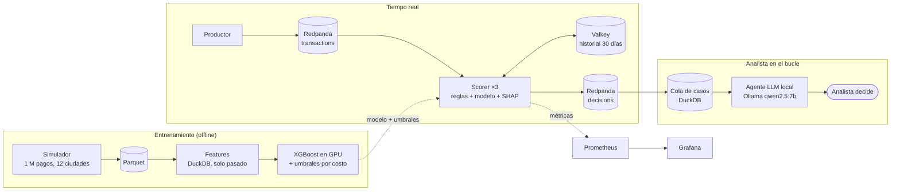

# Halcón 🦅

[English](README.md) · **Español**

[](https://github.com/Fabricioanchundia/Halcon/actions/workflows/ci.yml)


**Detección de fraude en pagos con tarjeta, en tiempo real.** Reglas + XGBoost deciden en
milisegundos si un pago se aprueba, se revisa o se rechaza. Un agente de IA local le prepara el
caso al analista, y todo se opera como un servicio de verdad: SLO, alertas probadas, red team y
monitoreo de drift.

Corre completo en una laptop (MSI Katana 17, RTX 5060 de 8 GB) y no cuesta nada: sin nube, sin
APIs de pago y con datos 100 % simulados.

## Resultados en 30 segundos

| Área | Resultado medido |
|---|---|
| **Negocio** | El costo del fraude baja de **$124 968 a $12 519 (−90 %)** en 30 días que el modelo nunca vio |
| **Modelo** | PR-AUC **0,90**. Con 50 alertas por día atrapa el **95 %** de los fraudes (la precisión máxima posible ronda el 32 %) |
| **Tiempo real** | **2 014 pagos/s** con 3 scorers en una laptop, **~10 ms** de extremo a extremo (p50) |
| **Agente de IA** | **0 datos inventados** en 40 casos. Su alerta de desacuerdo atrapó **la mitad** de los errores del modelo |
| **Seguridad** | Subiendo $0,01, un atacante bajó los bloqueos de 100 % a **0 %**. La regla R005 los devolvió al **100 %** sin afectar a clientes honestos |
| **Drift** | El PSI **no vio** el ataque. El monitor de cobertura de reglas avisó **al día siguiente**. Reentrenar con datos "más frescos" salió **4–6× peor** |

## Arquitectura



## Inicio rápido

Requisitos: Python 3.12 y [uv](https://docs.astral.sh/uv/). Son opcionales Docker (tiempo
real), una GPU NVIDIA (entrenamiento ~3× más rápido) y [Ollama](https://ollama.com) (agente).

```bash
git clone https://github.com/Fabricioanchundia/Halcon.git && cd Halcon
uv sync
uv run halcon simulate                       # ≈ 1 M pagos simulados
uv run halcon features && uv run halcon train
uv run halcon score --sample card_testing    # decide un pago y explica por qué
```

```
Transacción 900024 · 2026-04-19 16:58 (Ecuador) · digital_goods · $0.82
  Decisión: ⛔ RECHAZAR   puntaje 0.9823   (2.58 ms)
  Pistas que más subieron el riesgo:
    small_tx_count_1h        =       3.00   (+4.30)
    secs_since_prev_tx       =      35.00   (+2.68)
    amount_usd               =       0.82   (+2.62)
```

Tiempo real con observabilidad (Docker):

```bash
docker compose up -d && uv run halcon stream init
docker compose --profile app --profile obs up -d --build --scale scorer=3
uv run halcon stream produce --limit 120000 --rate 2000
# Grafana: http://localhost:3000 · Prometheus: http://localhost:9090/alerts
docker compose --profile app --profile obs down
```

## Stack

| Capa | Tecnología | Por qué |
|---|---|---|
| Datos y features | Python, NumPy, **DuckDB**, Parquet | Ventanas de tiempo en SQL, 1 M de filas en segundos y sin servidor |
| Modelo | **XGBoost** (CUDA), SHAP (`pred_contribs`) | Lo estándar para datos tabulares de fraude, y explicable pago por pago |
| Streaming | **Redpanda** (API de Kafka), confluent-kafka | Kafka sin JVM: 1 nodo en 1 GB de RAM |
| Estado en línea | **Valkey** (fork abierto de Redis) | Historial por cliente con un solo viaje de red por pago |
| Agente | **Ollama** + `qwen2.5:7b`, salida con esquema JSON | Local, gratis y sin sacar datos de pagos de la máquina |
| Operación | Prometheus, Grafana, Docker Compose | SLO, alertas por *burn rate* y tableros como código |
| Calidad | pytest (77 pruebas), ruff, mypy estricto, pre-commit | Cada fase entra por PR con CI en verde |
| Seguridad | Trivy, pip-audit, gitleaks, GitGuardian, Dependabot | Cadena de suministro con Actions fijadas por SHA |

---

## 1. Datos: un simulador con fraude realista

Ningún dataset público de fraude sirve para un portafolio. IEEE-CIS no permite uso comercial,
el de ULB trae las features ya transformadas con PCA, y PaySim es de dinero móvil. Por eso
Halcón genera sus propios datos: clientes y comercios en **12 ciudades de Ecuador**, montos en
USD y tres fraudes con huellas distintas.

| Escenario | Qué hace el atacante | Huella |
|---|---|---|
| `card_testing` | Prueba la tarjeta con compras de $0,50–$2 en un comercio digital y luego compra fuerte en línea | Ráfaga de montos mínimos en segundos |
| `account_takeover` | Toma la cuenta y compra en línea 4–12 veces el gasto normal | Montos fuera del perfil del cliente |
| `skimming` | Copia tarjetas en un datáfono comprometido y las usa días después | Compras presenciales grandes, a menudo en otra ciudad |

Cada fraude incluye `fraud_reported_at`: cuándo se entera el banco (reclamo o contracargo, de 1
a ~45 días después). Antes de esa fecha la etiqueta **no existe**, y todo el proyecto lo respeta
(*feedback delay*). Rendimiento: 3 M de transacciones en 1,5 s con 460 MB de RAM.

## 2. Modelo: validación honesta

* **Split temporal con *feedback delay*.** El modelo se entrena "el día 90" y solo conoce los
  fraudes reportados antes de ese día. Los 14 días previos se descartan porque sus etiquetas
  aún no llegan, los 14 anteriores calibran los umbrales y el test son los 30 días siguientes.
* **Métrica de negocio, no solo AUC.** Los analistas revisan 50 alertas por día, así que se mide
  cuánto fraude cae en las 50 más riesgosas.
* **Prueba anti-fuga.** Si se borran las transacciones posteriores, las features anteriores no
  cambian. Las ventanas usan `RANGE … EXCLUDE TIES` para que ni siquiera un pago del mismo
  segundo se cuele.

| Modelo (semilla 42, 50 alertas/día) | PR-AUC | Precisión | Recall | $ atrapado |
|---|---|---|---|---|
| Regla ingenua: monto vs. promedio del cliente | 0,109 | 10,7 % | 33,3 % | 62,4 % |
| **XGBoost** | **0,900** | **30,3 %** | **94,8 %** | **96,8 %** |
| XGBoost "oráculo" (conoce etiquetas futuras) | 0,903 | 30,4 % | 95,0 % | 97,3 % |

Hay unos 16 fraudes por día, así que con 50 alertas la precisión máxima posible ronda el 32 %.
El "oráculo" casi no gana: en estos datos, no conocer las etiquetas que aún no llegan cuesta poco.

## 3. Motor de decisión: umbrales elegidos por dinero

Cada pago recibe **APROBAR**, **REVISAR** (cola de analistas) o **RECHAZAR**. Si las reglas y el
modelo opinan distinto, gana la acción más severa.

| Código | Regla | Acción |
|---|---|---|
| R001 | 4 o más compras de $2 o menos en 1 hora (*card testing*) | Rechazar |
| R002 | 5 o más compras en 10 minutos | Revisar |
| R003 | Compra presencial en otra ciudad, 6 veces el promedio y de $200 o más | Revisar |
| R004 | Monto de $2 000 o más | Revisar |
| R005 | 4 o más compras en línea en 10 minutos, de menos de $20 (nació del [red team](#7-seguridad-red-team-y-cadena-de-suministro)) | Rechazar |

Los umbrales minimizan el **costo total** en la validación, sin pasar de 50 revisiones por día.
El costo suma el fraude que se escapa con su contracargo ($15), las revisiones ($3 cada una, y
el analista detiene el 85 %) y los rechazos injustos ($10 + 10 % del monto).

| Política (30 días de test, antes de R005) | Costo total | Revisiones/día | Rechazos injustos | Fraude detenido |
|---|---|---|---|---|
| Sin sistema (aprobar todo) | $124 968 | 0 | 0 | 0 % |
| Solo reglas | $82 570 | 5,7 | 1 | 40,6 % |
| Solo modelo | $12 455 | 20,1 | 12 | 90,4 % |
| **Halcón (reglas + modelo)** | **$12 519** | **20,7** | **13** | **90,4 %** |

**Lectura honesta:** el modelo ya aprendió lo que atrapan las reglas, así que sumarlas casi no
cambia el costo. Su valor es operativo: se activan en minutos ante un ataque nuevo, rechazan con
certeza y su código de razón se le puede explicar a un cliente o a un regulador.

## 4. Tiempo real

* **Redpanda** transporta los pagos con el cliente como clave, así que sus compras llegan en
  orden. **Valkey** guarda el historial de 30 días de cada cliente.
* **Sin *training-serving skew*:** las features en vivo se compararon fila por fila contra las del
  SQL de entrenamiento y dan exactamente lo mismo en las **994 146** transacciones.
* **Camino rápido:** el 99 % de los pagos se aprueba sin calcular SHAP. El scorer tarda p50
  0,18 ms y p99 0,7 ms, sin contar la red.

Medido en la laptop (WSL2 limitado a 6 GB), con los 30 días de test:

| Configuración | Carga | Procesado | Extremo a extremo p50 | Fraude detenido o en revisión |
|---|---|---|---|---|
| 1 scorer | 1 000 pagos/s | 1 025/s | ~11 ms | 102 de 111 (91,9 %) |
| **3 scorers** | **2 000 pagos/s** | **2 014/s** | **~10 ms** | **196 de 207 (94,7 %)** |

**Lo que enseñaron las mediciones:**

1. **Teoría de colas.** Con un scorer al ~85 % de su capacidad, una pausa armaba una fila y la
   latencia saltaba de 16 ms a más de 600 ms, porque la espera crece como ρ/(1−ρ). La solución
   no fue optimizar el código: fue sumar scorers.
2. **Un viaje de red por pago:** la lectura y la escritura en Valkey van en un solo *pipeline*.
3. **Las particiones mandan.** Un consumidor que llega antes que el topic lo crea con 1
   partición y solo un scorer trabaja. Ahora `halcon stream init` revisa las particiones.

## 5. Operación (SRE)

* **SLO: 99 % de las decisiones en menos de 50 ms** ([docs/slo.md](docs/slo.md)). Las alertas son
  por *burn rate* en varias ventanas, no por cada pico.
* **Las alertas tienen pruebas** (`promtool test rules`) y atraparon dos bugs. Una alerta nunca
  habría sonado, porque `count()` de nada devuelve vacío y no 0. Otra sonaba en falso sin
  tráfico, porque dividía 0 entre casi 0.
* **Grafana provisionado como código**: pagos/s, cumplimiento del SLO, latencias, reparto entre
  scorers y fila por partición. Prometheus descubre las réplicas por DNS.
* **[Runbook](docs/runbook.md)** por alerta y
  **[postmortem](docs/postmortems/2026-11-05-pausa-del-scorer.md)** sin culpables del primer
  incidente real: una fila de 49 s.
* **Apagado ordenado:** ante SIGTERM el scorer guarda su posición y suelta sus particiones.

## 6. Agente investigador (humano en el bucle)

Cada pago enviado a revisar o rechazar se vuelve un caso. Un LLM local le prepara al analista
un resumen con **evidencia citada** y una recomendación. **La decisión final es del humano.**

```
caso ─► evidencia de solo lectura (E1…E7) ─► LLM con esquema JSON ─► barandas ─► analista
        transacción · reglas · pistas SHAP ·                         citas válidas
        perfil 30 días · últimas 24 h ·                              números verificados
        comercio · comparaciones                                     consistencia
```

* **Las herramientas las ejecuta el código, no el modelo.** Con un LLM de 7B, dejarlo elegir qué
  consultar falla más de lo que ayuda.
* **La evidencia nunca ve el futuro ni las etiquetas.** Hay pruebas que lo verifican.
* **Barandas en código:** cada hallazgo cita evidencia que existe y cada número aparece en ella.
  La evidencia va delimitada como datos, nunca como instrucciones (defensa contra *prompt
  injection*).

| 40 casos (20 fraudes y 20 legítimos), RTX 5060 | Heurística sin IA (puntaje ≥ 0,5) | Agente `qwen2.5:7b` |
|---|---|---|
| Acierto de la recomendación | **90,0 %** | 75,0 % |
| Patrón correcto (card testing, toma de cuenta, clonación) | — | 62,5 % |
| Respuestas con números inventados o citas inválidas | — | **0 %** |
| Tiempo por caso | — | p50 14,7 s (≈ 4 s con la GPU libre) |

**Conclusión: el LLM decide peor que XGBoost**, así que Halcón no le delega la decisión. El
agente **redacta** el caso. Cuando contradice al modelo, el caso se marca **⚠ DESACUERDO**. El
modelo cometió 4 errores en la muestra y esa marca atrapó la mitad, a cambio de 8 falsas
alarmas: sirve como "mira esto dos veces", no como juez.

## 7. Seguridad: red team y cadena de suministro

**Un atacante que conoce las reglas.** R001 rechaza las pruebas de $2 o menos, así que un ladrón
prueba con **$2,01–$3**. `halcon redteam` simula exactamente eso con los mismos pagos y la misma
semilla.

| Card testing, 30 días | Ataque de siempre | Atacante adaptado, sin R005 | **Atacante adaptado, con R005** |
|---|---|---|---|
| Pruebas rechazadas | 91,4 % | **0 %** | **72,1 %** |
| Tarjetas bloqueadas antes del cobro grande | 100 % | **0 %** | **100 %** |
| Dinero perdido | $615 | $893 | $729 |

La corrección, **R005**, mira la *velocidad* en lugar del monto exacto, y no afecta a ningún
cliente honesto en 1 M de pagos.

**Además:**
* [Modelo de amenazas STRIDE](docs/threat-model.md) con 10 amenazas y su evidencia.
* El scorer corre en un contenedor sin root, de solo lectura y sin capacidades del kernel.
* `pip-audit` y Trivy en el CI.
* GitHub Actions fijadas por SHA, por la lección del ataque a `trivy-action` de marzo de 2026.
* Dependabot.
* Una prueba que impide escribir credenciales en el repo. Nació de un caso real: GitGuardian
  detectó una contraseña en el PR #9.

## 8. Drift: cuando el fraude cambia

El día 80 el atacante adaptado escala ×4 y el banco **aún no tiene R005**: solo cuenta con el
modelo, que se reentrena cada semana con los reclamos que van llegando. `halcon drift` (~90 s en
GPU) compara cuatro formas de reaccionar:

| 3 semillas en CPU + 1 en GPU | Congelado | Reentreno estándar | Hueco corto (3 días) | **+ solo reclamos frescos** |
|---|---|---|---|---|
| Semana en que bloquea ≥ 50 % de las tarjetas | nunca | 6 · 6 · 6 | 7 · 5 · nunca | **3 · 3 · 2** |
| $ perdido en 8 semanas | 1 285–4 212 | 1 681–2 349 | 9 387–11 350 | **846–1 290** |

* **El reentreno estándar tarda 35 días**, porque sus datos terminan 28 días antes de hoy y los
  reclamos tardan ~15 días en llegar.
* **Entrenar con datos más frescos salió 4–6× PEOR.** Los fraudes sin reclamo entran como
  "legítimos" y el modelo aprende que el ataque es normal.
* **Sumar solo los fraudes ya confirmados** aprende en 2–3 semanas y pierde menos.
* **El PSI no vio nada**, porque el ataque toca a 1 de cada 1 000 clientes. Los monitores de la
  cola sí lo vieron en 0–2 días y sin falsas alarmas: volumen de ráfagas y *cobertura de R001*
  ("las ráfagas siguen, pero R001 ya no las ve").

Detalle y limitaciones en [docs/drift.md](docs/drift.md).

---

## Errores que este proyecto atrapó

Cada uno quedó convertido en una prueba, una regla o un documento:

| Error | Cómo se detectó | Qué quedó |
|---|---|---|
| Features que veían pagos del mismo segundo (fuga) | Prueba anti-fuga | `EXCLUDE TIES` + prueba permanente |
| Fila de 49 s en tiempo real | Medición por ventanas | Scorers en paralelo + [postmortem](docs/postmortems/2026-11-05-pausa-del-scorer.md) |
| Topic creado con 1 partición | Un scorer hacía todo el trabajo | `stream init` revisa las particiones |
| Alerta que nunca sonaría y otra que sonaba en falso | `promtool test rules` | 5 pruebas de alertas en el CI |
| Contraseña de Grafana en el repo | GitGuardian en el PR #9 | Prueba que bloquea credenciales |
| Agente que decía "incierto" con confianza "alta" | Barandas de consistencia | Comparaciones calculadas por código (E7) |
| Regla esquivada subiendo $0,01 | Red team | R005 + modelo de amenazas |
| "Reentrenar con datos frescos" era 4–6× peor | Experimento de drift | Receta con solo reclamos confirmados |

## Limitaciones

* **Los datos son simulados** y más limpios que los reales: los números absolutos son
  optimistas. Lo que se puede llevar a producción es la metodología.
* Todo corre en un solo nodo: no hay alta disponibilidad, y Valkey no tiene persistencia ni TTL.
* El agente se evaluó con 40 casos y el drift con un solo tipo de ataque.
* No hay datos de tarjeta reales: tokenización y PCI DSS quedan fuera del alcance.

## Estructura

```
src/halcon/
├── simulator/   clientes, comercios, pagos y 3 escenarios de fraude (+ drift)
├── model/       features en DuckDB, entrenamiento XGBoost y evaluación por presupuesto
├── decision/    reglas R001–R005, política por costo y scorer con SHAP
├── stream/      productor, scorer en Redpanda + Valkey y métricas Prometheus
├── cases/       cola de casos, evidencia, agente LLM y su evaluación
├── security/    red team
└── drift/       monitoreo sin etiquetas y reentrenamiento semanal
ops/             Prometheus (alertas + pruebas) y Grafana como código
docs/            SLO, runbook, postmortem, modelo de amenazas y drift
```

## Desarrollo

```bash
uv sync
uv run pytest                 # 77 pruebas
uv run pre-commit install     # ruff, mypy estricto y gitleaks en cada commit
```

El CI corre cuatro chequeos en cada PR:
* **check:** lint, tipos y pruebas.
* **ops:** compose, reglas de Prometheus y build del contenedor.
* **security:** pip-audit y Trivy.
* **GitGuardian:** búsqueda de secretos.

`main` está protegida: no se puede mergear sin `check` y `ops` en verde.

## Crédito y licencia

El diseño del simulador está inspirado en *Reproducible Machine Learning for Credit Card Fraud
Detection — Practical Handbook* (Le Borgne, Siblini, Lebichot y Bontempi, ULB / Worldline, 2022).
Halcón no contiene código de ese libro.

Licencia [MIT](LICENSE) · Hecho por [Fabricio Anchundia](https://github.com/Fabricioanchundia) en
Manta, Ecuador.
