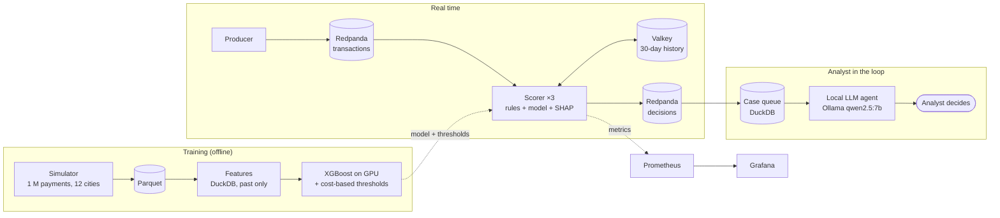

# Halcón 🦅

**English** · [Español](README.es.md)

[](https://github.com/Fabricioanchundia/Halcon/actions/workflows/ci.yml)


**Real-time card payment fraud detection.** Rules + XGBoost decide in milliseconds whether a
payment is approved, sent to review or declined. A local AI agent drafts each case for a human
analyst, and the whole system is operated like a production service: SLO, tested alerts, red
team and drift monitoring.

It runs end to end on a laptop (MSI Katana 17, RTX 5060 8 GB) at zero cost: no cloud, no paid
APIs and 100 % simulated data.

> The code comments, CLI output and the documents in `docs/` are in Spanish. This README is the
> English entry point.

## Results in 30 seconds

| Area | Measured result |
|---|---|
| **Business** | Fraud cost drops from **$124,968 to $12,519 (−90 %)** over 30 days the model never saw |
| **Model** | PR-AUC **0.90**. With 50 alerts per day it catches **95 %** of fraud (the best possible precision is ~32 %) |
| **Real time** | **2,014 payments/s** with 3 scorers on a laptop, **~10 ms** end to end (p50) |
| **AI agent** | **0 hallucinated numbers** in 40 cases. Its disagreement flag caught **half** of the model's errors |
| **Security** | Raising probes by $0.01, an attacker cut card blocks from 100 % to **0 %**. Rule R005 brought them back to **100 %** with no honest customers affected |
| **Drift** | PSI **missed** the attack. A rule-coverage monitor caught it **the next day**. Retraining on "fresher" data turned out **4–6× worse** |

## Architecture



## Quick start

Requirements: Python 3.12 and [uv](https://docs.astral.sh/uv/). Optional: Docker (real time),
an NVIDIA GPU (~3× faster training) and [Ollama](https://ollama.com) (agent).

```bash
git clone https://github.com/Fabricioanchundia/Halcon.git && cd Halcon
uv sync
uv run halcon simulate                       # ≈ 1 M simulated payments
uv run halcon features && uv run halcon train
uv run halcon score --sample card_testing    # decides one payment and explains why
```

```
Transacción 900024 · 2026-04-19 16:58 (Ecuador) · digital_goods · $0.82
  Decisión: ⛔ RECHAZAR   puntaje 0.9823   (2.58 ms)
  Pistas que más subieron el riesgo:
    small_tx_count_1h        =       3.00   (+4.30)
    secs_since_prev_tx       =      35.00   (+2.68)
    amount_usd               =       0.82   (+2.62)
```

*(Decision: DECLINE, score 0.98. The top risk signals are SHAP values: 3 tiny purchases in the
last hour, 35 s since the previous one, and a $0.82 amount.)*

Real time with observability (Docker):

```bash
docker compose up -d && uv run halcon stream init
docker compose --profile app --profile obs up -d --build --scale scorer=3
uv run halcon stream produce --limit 120000 --rate 2000
# Grafana: http://localhost:3000 · Prometheus: http://localhost:9090/alerts
docker compose --profile app --profile obs down
```

## Stack

| Layer | Technology | Why |
|---|---|---|
| Data and features | Python, NumPy, **DuckDB**, Parquet | Time windows in SQL, 1 M rows in seconds, no server |
| Model | **XGBoost** (CUDA), SHAP (`pred_contribs`) | The standard for tabular fraud data, explainable per payment |
| Streaming | **Redpanda** (Kafka API), confluent-kafka | Kafka without the JVM: one node in 1 GB of RAM |
| Online state | **Valkey** (open-source Redis fork) | Per-customer history with a single network round trip per payment |
| Agent | **Ollama** + `qwen2.5:7b`, JSON-schema output | Local, free, and payment data never leaves the machine |
| Operations | Prometheus, Grafana, Docker Compose | SLO, burn-rate alerts and dashboards as code |
| Quality | pytest (77 tests), ruff, strict mypy, pre-commit | Every phase merged through a PR with green CI |
| Security | Trivy, pip-audit, gitleaks, GitGuardian, Dependabot | Supply chain with SHA-pinned GitHub Actions |

---

## 1. Data: a simulator with realistic fraud

No public fraud dataset fits a portfolio project. IEEE-CIS forbids commercial use, the ULB
dataset ships PCA-transformed features, and PaySim is about mobile money. So Halcón generates its
own data: customers and merchants across **12 Ecuadorian cities**, amounts in USD, and three
fraud patterns with distinct footprints.

| Scenario | What the attacker does | Footprint |
|---|---|---|
| `card_testing` | Tests the card with $0.50–$2 purchases at a digital merchant, then buys big online | A burst of tiny amounts within seconds |
| `account_takeover` | Takes over the account and buys online at 4–12× normal spending | Amounts far outside the customer's profile |
| `skimming` | Copies cards at a compromised terminal and uses them days later | Large in-person purchases, often in another city |

Every fraud has a `fraud_reported_at` timestamp: when the bank finds out (a claim or chargeback,
1 to ~45 days later). Before that date the label **does not exist**, and the whole project
respects it (*feedback delay*). Speed: 3 M transactions in 1.5 s using 460 MB of RAM.

## 2. Model: honest validation

* **Time-based split with feedback delay.** The model is trained "on day 90" and only knows the
  frauds reported before that day. The 14 days right before the cutoff are dropped because
  their labels have not arrived yet, the 14 days before that tune the thresholds, and the test
  set is the following 30 days.
* **A business metric, not just AUC.** Analysts review 50 alerts per day, so we measure how much
  fraud falls inside the 50 riskiest payments.
* **Leakage test.** Deleting later transactions does not change earlier features. Windows use
  `RANGE … EXCLUDE TIES`, so not even a payment from the same second can leak in.

| Model (seed 42, 50 alerts/day) | PR-AUC | Precision | Recall | $ caught |
|---|---|---|---|---|
| Naive rule: amount vs. customer average | 0.109 | 10.7 % | 33.3 % | 62.4 % |
| **XGBoost** | **0.900** | **30.3 %** | **94.8 %** | **96.8 %** |
| XGBoost "oracle" (knows future labels) | 0.903 | 30.4 % | 95.0 % | 97.3 % |

There are about 16 frauds per day, so with 50 alerts the best possible precision is ~32 %. The
oracle barely wins: on this data, missing the labels that have not arrived yet costs little.

## 3. Decision engine: thresholds chosen by money

Each payment gets **APPROVE**, **REVIEW** (analyst queue) or **DECLINE**. When the rules and the
model disagree, the most severe action wins.

| Code | Rule | Action |
|---|---|---|
| R001 | 4+ purchases of $2 or less within 1 hour (card testing) | Decline |
| R002 | 5+ purchases within 10 minutes | Review |
| R003 | In-person purchase in another city, 6× the average and $200 or more | Review |
| R004 | Amount of $2,000 or more | Review |
| R005 | 4+ online purchases under $20 within 10 minutes (born from the [red team](#7-security-red-team-and-supply-chain)) | Decline |

The thresholds minimize the **total cost** on the validation period, with at most 50 reviews per
day. The total cost adds up missed fraud plus its chargeback fee ($15), reviews ($3 each; the
analyst stops 85 % of the fraud they review) and false declines ($10 + 10 % of the amount).

| Policy (30 test days, before R005) | Total cost | Reviews/day | False declines | Fraud stopped |
|---|---|---|---|---|
| No system (approve everything) | $124,968 | 0 | 0 | 0 % |
| Rules only | $82,570 | 5.7 | 1 | 40.6 % |
| Model only | $12,455 | 20.1 | 12 | 90.4 % |
| **Halcón (rules + model)** | **$12,519** | **20.7** | **13** | **90.4 %** |

**Honest reading:** the model already learned what the rules catch, so adding them barely changes
the cost. Their value is operational: they can be switched on in minutes against a new attack,
they decline with certainty, and their reason code can be explained to a customer or a regulator.

## 4. Real time

* **Redpanda** carries the payments keyed by customer, so each customer's purchases arrive in
  order. **Valkey** keeps each customer's 30-day history.
* **No training-serving skew:** live features were compared row by row with the training SQL.
  They match exactly on all **994,146** transactions.
* **Fast path:** 99 % of payments are approved without computing SHAP. The scorer takes p50
  0.18 ms and p99 0.7 ms, excluding the network.

Measured on the laptop (WSL2 capped at 6 GB) with the 30 test days:

| Setup | Load | Processed | End to end p50 | Fraud stopped or reviewed |
|---|---|---|---|---|
| 1 scorer | 1,000 payments/s | 1,025/s | ~11 ms | 102 of 111 (91.9 %) |
| **3 scorers** | **2,000 payments/s** | **2,014/s** | **~10 ms** | **196 of 207 (94.7 %)** |

**What the measurements taught:**

1. **Queueing theory.** With one scorer at ~85 % capacity, any pause built a queue and latency
   jumped from 16 ms to over 600 ms, because waiting time grows like ρ/(1−ρ). The fix was not
   faster code. The fix was more scorers.
2. **One network round trip per payment:** the Valkey read and write share a single pipeline.
3. **Partitions rule.** A consumer that subscribes before the topic exists creates it with 1
   partition, and then only one scorer does any work. `halcon stream init` now checks the
   partitions.

## 5. Operations (SRE)

* **SLO: 99 % of decisions in under 50 ms** ([docs/slo.md](docs/slo.md)). Alerts use multi-window
  *burn rates*, not every spike.
* **Alerts have tests** (`promtool test rules`), and they caught two bugs. One alert could never
  have fired, because `count()` over nothing returns empty, not 0. Another fired falsely with no
  traffic, because it divided 0 by almost 0.
* **Grafana provisioned as code**: payments/s, SLO compliance, latencies, load per scorer and lag
  per partition. Prometheus finds the replicas through DNS.
* **[Runbook](docs/runbook.md)** for every alert, and a blameless
  **[postmortem](docs/postmortems/2026-11-05-pausa-del-scorer.md)** of the first real incident: a
  49-second queue.
* **Graceful shutdown:** on SIGTERM the scorer commits its offsets and releases its partitions.

## 6. Investigator agent (human in the loop)

Every payment sent to review or declined becomes a case. A local LLM drafts a summary for the
analyst, with **cited evidence** and a recommendation. **The final decision is always the
human's.**

```
case ─► read-only evidence (E1…E7) ─► LLM with JSON schema ─► guardrails ─► analyst
        transaction · rules · SHAP signals ·                  valid citations
        30-day profile · last 24 h ·                          verified numbers
        merchant · comparisons                                consistency
```

* **Code runs the tools, not the model.** With a 7B LLM, letting it choose what to query fails
  more often than it helps.
* **The evidence never sees the future or the labels.** Tests check this.
* **Guardrails in code:** every finding must cite evidence that exists, and every number must
  appear in that evidence. The evidence is delimited as data, never as instructions (a defense
  against *prompt injection*).

| 40 cases (20 fraud, 20 legit), RTX 5060 | Heuristic, no AI (score ≥ 0.5) | `qwen2.5:7b` agent |
|---|---|---|
| Correct recommendation | **90.0 %** | 75.0 % |
| Correct pattern (card testing, takeover, cloning) | — | 62.5 % |
| Answers with made-up numbers or invalid citations | — | **0 %** |
| Time per case | — | p50 14.7 s (≈ 4 s with a free GPU) |

**Conclusion: the LLM decides worse than XGBoost**, so Halcón does not let it decide. The agent
**writes up** the case. When it contradicts the model, the case is flagged **⚠ DISAGREEMENT**.
The model made 4 mistakes in the sample, and that flag caught half of them at the cost of 8
false alarms. It works as a "look twice" signal, not as a judge.

## 7. Security: red team and supply chain

**An attacker who knows the rules.** R001 declines test purchases of $2 or less, so a thief
tests with **$2.01–$3** instead. `halcon redteam` simulates exactly that, with the same payments
and the same seed.

| Card testing, 30 days | Usual attack | Adapted attacker, without R005 | **Adapted attacker, with R005** |
|---|---|---|---|
| Test purchases declined | 91.4 % | **0 %** | **72.1 %** |
| Cards blocked before the big purchase | 100 % | **0 %** | **100 %** |
| Money lost | $615 | $893 | $729 |

The fix, **R005**, looks at *velocity* instead of the exact amount, and it affects no honest
customer across 1 M payments.

**Also:**
* A [STRIDE threat model](docs/threat-model.md) with 10 threats and their evidence.
* The scorer runs in a non-root, read-only container with no kernel capabilities.
* `pip-audit` and Trivy in CI.
* GitHub Actions pinned by SHA, a lesson from the March 2026 attack on `trivy-action`.
* Dependabot.
* A test that blocks credentials from being committed. It came from a real case: GitGuardian
  caught a password in PR #9.

## 8. Drift: when fraud changes

On day 80 the adapted attacker scales up ×4, and the bank **does not have R005 yet**. It only
has the model, which is retrained every week with the claims that have arrived so far.
`halcon drift` (~90 s on GPU) compares four ways to react:

| 3 seeds on CPU + 1 on GPU | Frozen | Standard retraining | Short gap (3 days) | **+ confirmed recent fraud only** |
|---|---|---|---|---|
| Week it first blocks ≥ 50 % of cards | never | 6 · 6 · 6 | 7 · 5 · never | **3 · 3 · 2** |
| $ lost over 8 weeks | 1,285–4,212 | 1,681–2,349 | 9,387–11,350 | **846–1,290** |

* **Standard retraining takes 35 days.** Its data ends 28 days before today, and claims take
  ~15 days to arrive.
* **Training on fresher data was 4–6× WORSE.** Frauds without a claim yet enter training as
  "legitimate", so the model learns that the attack is normal.
* **Adding only already-confirmed frauds** learns in 2–3 weeks and loses less.
* **PSI saw nothing**, because the attack touches 1 in 1,000 customers. The tail monitors caught
  it in 0–2 days with no false alarms: burst volume and *R001 coverage* ("the bursts keep
  coming, but R001 no longer sees them").

Details and limitations in [docs/drift.md](docs/drift.md) (in Spanish).

---

## Mistakes this project caught

Each one became a test, a rule or a document:

| Mistake | How it was caught | What stayed |
|---|---|---|
| Features that saw payments from the same second (leakage) | Leakage test | `EXCLUDE TIES` + permanent test |
| A 49-second queue in real time | Windowed measurements | Parallel scorers + [postmortem](docs/postmortems/2026-11-05-pausa-del-scorer.md) |
| Topic created with 1 partition | One scorer did all the work | `stream init` checks partitions |
| An alert that could never fire, and one that fired falsely | `promtool test rules` | 5 alert tests in CI |
| A Grafana password in the repo | GitGuardian on PR #9 | A test that blocks credentials |
| Agent answering "uncertain" with "high" confidence | Consistency guardrail | Comparisons computed by code (E7) |
| A rule evaded by raising $0.01 | Red team | R005 + threat model |
| "Retrain on fresh data" was 4–6× worse | Drift experiment | Recipe with confirmed claims only |

## Limitations

* **The data is simulated** and cleaner than real data, so the absolute numbers are optimistic.
  What carries over to production is the methodology.
* Everything runs on a single node: no high availability, and Valkey has no persistence or TTL.
* The agent was evaluated on 40 cases, and drift on a single attack type.
* No real card data: tokenization and PCI DSS are out of scope.

## Layout

```
src/halcon/
├── simulator/   customers, merchants, payments and 3 fraud scenarios (+ drift)
├── model/       DuckDB features, XGBoost training and budget-based evaluation
├── decision/    rules R001–R005, cost-based policy and scorer with SHAP
├── stream/      producer, Redpanda + Valkey scorer and Prometheus metrics
├── cases/       case queue, evidence, LLM agent and its evaluation
├── security/    red team
└── drift/       label-free monitoring and weekly retraining
ops/             Prometheus (alerts + tests) and Grafana as code
docs/            SLO, runbook, postmortem, threat model and drift (in Spanish)
```

## Development

```bash
uv sync
uv run pytest                 # 77 tests
uv run pre-commit install     # ruff, strict mypy and gitleaks on every commit
```

CI runs four checks on every PR:
* **check:** lint, types and tests.
* **ops:** Compose, Prometheus rules and the container build.
* **security:** pip-audit and Trivy.
* **GitGuardian:** secret scanning.

`main` is protected: nothing merges without `check` and `ops` passing.

## Credits and license

The simulator design is inspired by *Reproducible Machine Learning for Credit Card Fraud
Detection — Practical Handbook* (Le Borgne, Siblini, Lebichot and Bontempi, ULB / Worldline,
2022). Halcón contains no code from that book.

[MIT](LICENSE) license · Built by [Fabricio Anchundia](https://github.com/Fabricioanchundia) in
Manta, Ecuador.
